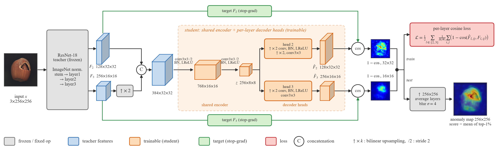

# Unsupervised anomaly detection on MVTec AD

Unsupervised visual anomaly detection on the 15 classes of MVTec AD: the models see only normal images during
training, while at test time they must predict an anomaly score for each image and localize the defects (if
present) at pixel level. The project has four parts:

1. a first **custom model** based on **pixel reconstruction** (convolutional autoencoder). Its results were too
   low, so it was replaced by the second approach and is kept only as a reference;
2. the actual **custom model**, based on **feature reconstruction** (teacher-student), built through an ablation
   study;
3. a **comparison** with two methods from the literature, **PatchCore** and **PaDiM**;
4. an **error analysis** of the feature reconstruction model, PatchCore and PaDiM: defect types that are hard for
   all of them, and cases where the custom model is worse, traced back to its architecture.

## Results

Mean over the 15 classes (all models trained and evaluated with the same split, pre-processing and metrics):

| model | Image AUROC | Pixel AUROC | AUPRO |
|---|---|---|---|
| Custom: pixel reconstruction | 0.783 | 0.870 | 0.752 |
| Custom: feature reconstruction | 0.962 | 0.962 | 0.899 |
| PatchCore | 0.978 | 0.978 | 0.928 |
| PaDiM | 0.881 | 0.970 | 0.921 |

Both custom models were developed starting from a simple baseline and trying to improve it step by step; the table
reports the final version of each:

- **pixel reconstruction**: convolutional autoencoder with residual blocks that reconstructs the image, trained
  with an L1 + SSIM loss. The anomaly map is the reconstruction error;
- **feature reconstruction**: frozen ResNet-18 teacher (`layer2` + `layer3`) and a student autoencoder with a shared
  encoder and one decoder head per feature layer of the teacher. The anomaly map is 1 - cosine similarity between teacher and
  reconstructed features, smoothed with Gaussian blur. This is the custom model used in the comparison
  and in the error analysis:



## Notebooks

The notebooks are mainly used to run the experiments and show their results: most of the code is in the Python
modules (see the repository structure below). To see what was done, start from the notebooks, in this order:

| notebook | content |
|---|---|
| `pixel_reconstruction.ipynb` | first approach: convolutional autoencoder trained to reconstruct the input image (5 variants) |
| `feature_reconstruction.ipynb` | custom model: baseline and ablation study (layers, loss, layer fusion, identity shortcut, backbone, smoothing of the map) |
| `patchCore.ipynb` | PatchCore (anomalib implementation) under the project's protocol |
| `PaDiM.ipynb` | PaDiM (anomalib implementation) under the project's protocol |
| `error_analysis.ipynb` | comparison of the three models: per defect type, false positives/negatives, anomaly maps |


## Repository structure

| path | content |
|---|---|
| `dataset.py` | `MVTec2DDataset`: images, ground-truth masks, labels and defect types |
| `models/pixel_autoencoder.py` | pixel autoencoder (convolutional or residual blocks, optional linear bottleneck) |
| `models/feature_autoencoder.py` | frozen teacher and student models for feature reconstruction |
| `models/literature_models.py` | wrappers around the anomalib torch models of PatchCore and PaDiM |
| `losses.py` | reconstruction losses (MSE, L1 + SSIM, cosine) |
| `engine.py` | training loop with early stopping, evaluation (Image AUROC, Pixel AUROC, AUPRO) |
| `run_experiment.py` | data loaders, model construction, training and evaluation of one class (custom models) |
| `run_literature.py` | fit and evaluation of one class (PatchCore, PaDiM: no training, only a fit of feature statistics) |
| `utils/` | train/validation split, seeds and smoothing, visualization of the anomaly maps |
| `figures/` | figures of the architectures |
| `experiments/` | results: one folder per approach, experiment and class |

## How to run

Python 3.12. Install the dependencies:

```bash
pip install -r requirements.txt
```

The experiments use a CUDA GPU (`'device': 'cuda'` in the notebooks). On Windows the default PyTorch wheels are
CPU-only: to get the CUDA build used for the experiments (CUDA 13.0), install with

```bash
pip install -r requirements.txt --extra-index-url https://download.pytorch.org/whl/cu130
```

**Dataset.** Download MVTec AD from the [MVTec website](https://www.mvtec.com/company/research/datasets/mvtec-ad)
and extract it so that each class is in `data/MVTec/<class>/` (with `train/`, `test/` and `ground_truth/`).

**Train/validation split (run once, before any notebook).** MVTec AD has no validation set. 15% of the normal
training images of each class are moved to a validation set, used for early stopping; the original
training set is kept in `train_original/`. All the notebooks expect this split, so run it once after downloading
the dataset, from the root of the repository:

```python
from utils.data_split import split_data
split_data(root="./data/MVTec", val_ratio=0.15)
```

After that the notebooks can be run in any order. Running the split again does nothing on an already split
dataset.

## Reproducing the results

Run the notebooks: each experiment is a config dictionary followed by a loop over the 15 classes. Results are
written to `experiments/<approach>/<experiment>/<class>/`:

- `metrics.json`: Image AUROC, Pixel AUROC, AUPRO (and, for PatchCore and PaDiM, also the Image AUROC with the top-1% score);
- `image_scores.csv`: anomaly score of every test image, used by the error analysis;
- `config.json` and `overall_results.csv` for each experiment.

Model weights are **not** in the repository because they are too large: the checkpoints of the trained models (`checkpoints/`) and
the PatchCore memory banks (`memory_bank.pt`) are excluded. The metrics and the per-image scores of the three
compared models are included, so the result tables and Part 1 of the error analysis can be run without retraining; to regenerate anomaly maps (visualization cells, Part 2
of the error analysis), the corresponding experiments must be run again first. 
